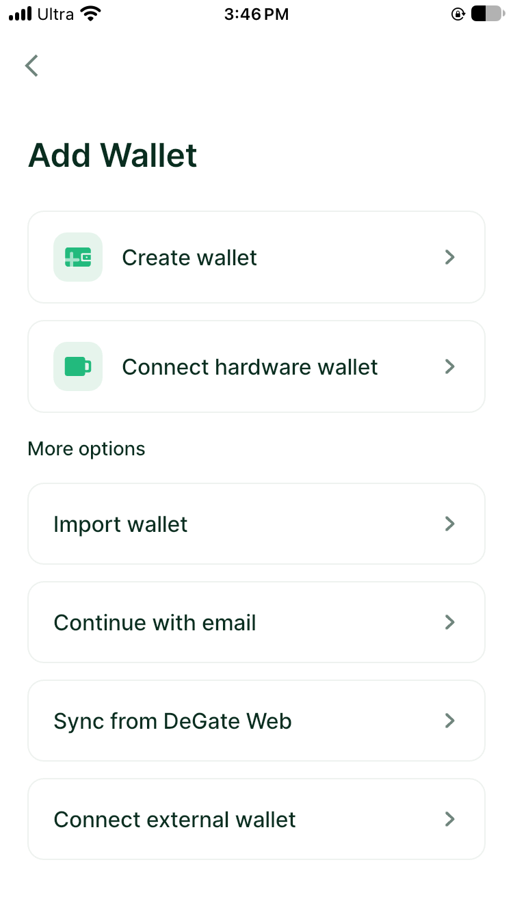

# Create a Wallet

Install the iOS or Android app, then choose how you want to add a wallet. Check the backup and recovery requirements for the method you choose.

  

## Ways to add a wallet

Choose one of the six options on the **Add Wallet** screen:

* **Create wallet:** generate a new wallet with a 12-word recovery phrase, created locally on your device. Write the phrase down and store it offline. [See how to find and back up your recovery phrase](../security/self-custody-faq.md#what-do-i-need-to-back-up).
* **Connect hardware wallet:** connect a Bluetooth-capable OneKey or Ledger model. Check the connection screen for supported models and networks. See the FAQ below.
* **Import wallet:** bring an existing 12-word recovery phrase.
* **Continue with email:** add or access a wallet with your email address and the six-digit verification code sent to it. Then choose how to unlock the app on this device, with a password or biometrics. This unlock method protects data stored on the device. On a new device, sign in with the same email address and a new code, then set up the unlock method again.
* **Sync from DeGate Web:** scan a QR code generated on DeGate Web to bring an existing web account into the mobile app. [See the steps below](#sync-an-existing-degate-web-account).
* **Connect external wallet:** connect or reconnect your external wallet directly in the app via WalletConnect (up to 10 external wallet accounts).


We do not recommend keeping large balances in an email wallet. If you permanently lose access to its linked email, you may be unable to recover it. For higher-value assets, we recommend **Create wallet** or **Import wallet** (or connecting a hardware wallet), so that you hold the recovery phrase yourself.


## Sync an existing DeGate Web account

1. On a computer, open DeGate Web and connect the wallet account you originally used there.
2. Select **Sync Account to DeGate App**, then select **Generate** and sign with the connected wallet to create a QR code.
3. In the DeGate app, go to **Add Wallet → Sync from DeGate Web → Scan** and scan the code within 60 seconds.

Generate and scan the code in private. Stop any screen sharing, recording, or livestream before generating it. Do not share the QR code.

Use the iOS or Android app for swaps, transfers, and Turbo Range position actions.

## FAQ

**Do I need a separate wallet for each chain?**
No. One DeGate wallet gives you addresses across supported chains, generated as you enable each chain and controlled by your keys. See [Wallet Addresses & Networks](../security/wallet-address-and-networks.md).

**Who holds the keys of the wallet I just created?**
It depends on the wallet type. Recovery phrase wallets keep keys on your device; hardware wallets keep them on the hardware device. Email wallets and external-wallet connections have different key handling and recovery dependencies. Read [Security Overview](../security/security-overview.md) and [Wallet Addresses & Networks](../security/wallet-address-and-networks.md) for your chosen method.

**Does creating a wallet require identity verification?**
No. DeGate does not require identity verification to create a wallet.

**Can I use a hardware wallet?**
Yes. Connect a **Bluetooth-capable OneKey or Ledger model** in the DeGate mobile app. Check the connection screen for supported models and networks. Hardware-wallet accounts support receiving, sending, trading, cross-chain transfers, and Turbo Range. Confirm signatures on the hardware device; do not enter its recovery phrase into your phone.

Hardware-wallet accounts pay network gas from their own address in the chain's native token. Keep enough native tokens there (for example, ETH on Base) for the action you intend to sign. Review network costs on the confirmation screen.
