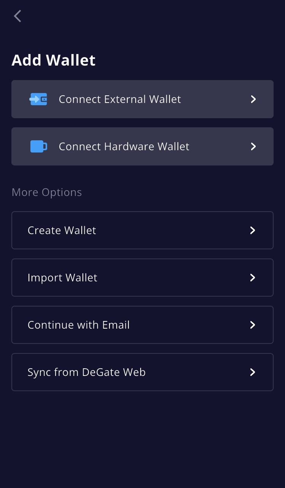

# Create a Wallet

Install the iOS or Android app, then choose how you want to add a wallet. Check the backup and recovery requirements for the method you choose.

  

## Ways to add a wallet

Choose one of the six options on the **Add Wallet** screen:

* **Connect External Wallet:** sign in with a wallet you already have, via WalletConnect (up to 10 external wallet accounts).
* **Connect Hardware Wallet:** Connect a Bluetooth-capable OneKey or Ledger model. Check the connection screen for supported models and networks. See the FAQ below.
* **Create Wallet:** generate a new wallet with a 12-word recovery phrase, created locally on your device. Write the phrase down and store it offline.
* **Import Wallet:** bring an existing 12-word recovery phrase.
* **Continue with Email:** add a wallet through email sign-in. Enter your email, confirm the code from your inbox, and set a DeGate password (separate from the password you use to sign in to your email provider).
* **Sync from DeGate Web:** bring an account you use on the DeGate web app into the app.


We do not recommend keeping large balances in an email wallet. If you permanently lose access to its linked email, you may be unable to recover it. For higher-value assets, we recommend **Create Wallet** or **Import Wallet** (or connecting a hardware wallet), so that you hold the recovery phrase yourself.


## Web accounts and mobile transactions

The web app does not support transactions. Use the iOS or Android mobile app for swaps, transfers, and Turbo Range position actions. If you already use a DeGate web account, choose **Sync from DeGate Web** in the mobile app to bring it into the app.

## FAQ

**Do I need a separate wallet for each chain?**
No. One DeGate wallet gives you addresses across supported chains, generated as you enable each chain and controlled by your keys. See [Wallet Addresses & Networks](../security/wallet-address-and-networks.md).

**Who holds the keys of the wallet I just created?**
It depends on the wallet type. Recovery phrase wallets keep keys on your device; hardware wallets keep them on the hardware device. Email wallets and external-wallet connections have different key handling and recovery dependencies. Read [Security Overview](../security/security-overview.md) and [Wallet Addresses & Networks](../security/wallet-address-and-networks.md) for your chosen method.

**Does creating a wallet require identity verification?**
You can create a recovery phrase wallet without uploading identity documents or completing exchange-style identity verification. **Continue with Email** has a separate sign-in setup, including email verification and a DeGate password. A third-party service you use may have its own identity and regional requirements; check those requirements before using it.

**Can I use a hardware wallet?**
Yes. Connect a **Bluetooth-capable OneKey or Ledger model** in the DeGate mobile app. Check the connection screen for supported models and networks. Hardware-wallet accounts support receiving, sending, trading, cross-chain transfers, and Turbo Range. Confirm signatures on the hardware device; do not enter its recovery phrase into your phone.

Hardware-wallet accounts pay network gas from their own address in the chain's native token. Keep enough native tokens there (for example, ETH on Base) for the action you intend to sign. Review network costs on the confirmation screen.
